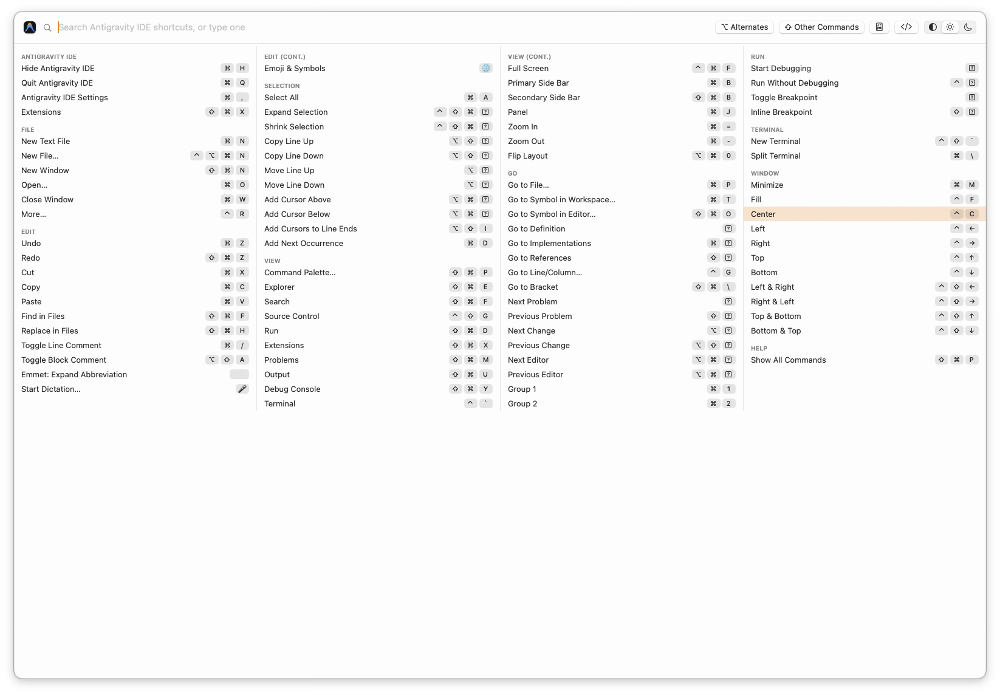
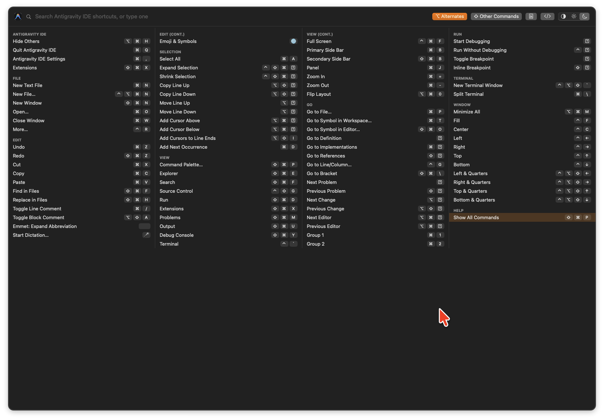

# autoKSHelp

A macOS menubar app that pops up the keyboard shortcuts of the frontmost app, read from its menu bar. Built with Swift/SwiftUI. Version 0.0.17.




## Install from a release

1. Download `autoKSHelp-<version>.zip` from the [latest release](https://github.com/sandipchitale/autoKSHelp/releases/latest) and unzip it.
2. Move `autoKSHelp.app` to `/Applications`.
3. The app is signed with a local certificate and is **not notarized**, so macOS Gatekeeper blocks the first launch. Either right-click the app → **Open** → **Open**, or run `xattr -dr com.apple.quarantine /Applications/autoKSHelp.app`.
4. When prompted, grant Accessibility permission (System Settings › Privacy & Security › Accessibility). The ⌘ icon then appears in the menubar; press **⌃⌘/** to try it.

To update, quit the app from its menubar menu, replace it in `/Applications` and launch it again.

## Usage

| Action | How |
| --- | --- |
| Show / hide | **⌃⌘/** (or menubar icon → *Show Shortcuts*) |
| Open with other commands shown | **⇧⌃⌘/** |
| Show / hide other commands (popup open) | Tap **⇧ Shift** on its own, or click the **⇧ Other Commands** header button |
| Show / hide alternate menu items inline below their base items (popup open) | Tap **⌥ Option** on its own, or click the **⌥ Alternates** header button |
| Navigate the list | **↑ ↓** within a column, **← →** between columns (while the search box is empty), **Tab** / **⇧Tab** next / previous |
| Search | Just type (title, menu path or keys) |
| Run a command | Click a row, press **Enter** (the highlighted row — the first one by default), or type its shortcut (needs ⌘ or ⌃, or an F-key) |
| Save the current view | Header buttons **PDF** (document icon) and **HTML** (`</>` icon) — landscape, see below |
| Just view it, without saving | Turn on the **eye** toggle (left of PDF / HTML): the file is written to a temporary folder and opened in your default viewer, no save dialog |
| Hide | **Esc** or click elsewhere |
| Move | Drag any empty part of the popup |

The popup has four columns, a fixed height (70% of the screen), light/dark/system appearance buttons, and two header toggle buttons, **⌥ Alternates** and **⇧ Other Commands**, whose labels show the key that toggles them. *Other Commands* are enabled menu items without a shortcut, listed below the shortcuts.

Shift and Option toggle only when tapped *exclusively* (pressed and released alone, with no other key or modifier in between), so ⇧Tab or ⌥⌘W never toggle anything. The toggle happens on release.

## Saving as PDF / HTML

The two header buttons save exactly what the popup currently shows — search filter, *Other Commands*, and light/dark appearance — through a standard save dialog (defaults to Downloads).

- **Landscape**, 4 columns, with the app's icon and name, item count and date in the header.
- **Both variants at once:** each item's Option alternate is listed right below it (indented, orange, with its ⌥ key) regardless of whether Alternates is toggled on.
- **PDF** is paginated (A4 in metric locales, US Letter otherwise) with vector text; groups continue on the next column/page with a "(cont.)" header.
- **HTML** is a single self-contained file (the icon is embedded) that also prints landscape.
- **View mode:** with the **eye** toggle on (remembered between launches), the PDF / HTML buttons skip the save dialog, write the file to a temporary folder (`autoKSHelp-preview`, overwritten on each view) and open it in the default viewer (Preview / your browser).

## Changelog

- **0.0.17** — Alternates are now listed inline, right below the item they replace (indented, in the accent color of the Alternates button), instead of replacing it.
- **0.0.16** — the popup header shows the release version.
- **0.0.15** — removed the "Show Other Commands" item from the menubar menu (still available via the header button, Shift tap and ⇧⌃⌘/).
- **0.0.14** — eye toggle: view the PDF / HTML export immediately (temporary file, opened in the default viewer) instead of going through the save dialog.
- **0.0.13** — fix: shortcuts using arrow keys or F-keys (e.g. F8, ⌥⌘→) showed a "?" box instead of the key; they now show ↑ ↓ ← → and F1–F35, and typing such a shortcut in the popup now runs it.
- **0.0.12** — README: light and dark (Alternates on) screenshots; no functional changes.
- **0.0.11** — save the current view as landscape PDF or HTML (header buttons): includes the app icon, shows Alternates inline below their items, matches the popup's appearance.
- **0.0.10** — keyboard navigation (arrows, Tab / ⇧Tab, Enter runs the highlighted row, hover also highlights); Shift and Option toggle only when tapped exclusively (on release).
- **0.0.9** — fix: an empty "autoKSHelp Settings" window opened at every launch (from a placeholder SwiftUI scene); the app now starts with a plain AppKit entry point and opens no window.
- **0.0.8** — README: instructions for installing from a release.
- **0.0.7** — README screenshot; no functional changes.
- **0.0.6** — Alternates and Other Commands are now toggle buttons in the header, each labelled with its key (⌥ / ⇧); the old state-changing label is gone.
- **0.0.5** — Option is now a toggle (press to show/hide alternates, no need to hold it); the header label reads "Alternates" when on.
- **0.0.4** — ⌃⌘/ now only shows (shortcuts only) or hides the popup; the header always shows a "Hold ⌥ for alternates" hint.
- **0.0.3** — with the popup open, pressing **Shift** alone shows/hides the other commands; ⇧⌃⌘/ now only opens the popup with them shown.
- **0.0.2** — hotkey changed from ⌃⌥⌘/ to **⌃⌘/** (and ⇧⌃⌘/): holding Option as part of the hotkey made the Option alternates show as soon as the popup opened.
- **0.0.1** — first release.

## Requirements

macOS 13+, Swift 5.9+ toolchain. Grant Accessibility permission (System Settings › Privacy & Security › Accessibility).

## Build from source

```sh
./build.sh      # release build -> autoKSHelp.app (codesigned)
./install.sh    # build, sign, install to /Applications, launch
swift test      # unit tests
```

Signing uses a local certificate ("CmdTab Local Signing" / "autoKSHelp Local Signing", created if missing) so the Accessibility grant survives rebuilds; override with `CODESIGN_IDENTITY`.

## Layout

- `Sources/KSCore` — shortcut model, key/modifier formatting, matching, PDF/HTML export layout and rendering (unit tested)
- `Sources/autoKSHelp` — app (`main.swift` AppKit entry), Accessibility menu reader, popup panel, SwiftUI view, hotkeys
- `SPEC.md` — original spec plus implemented behavior
